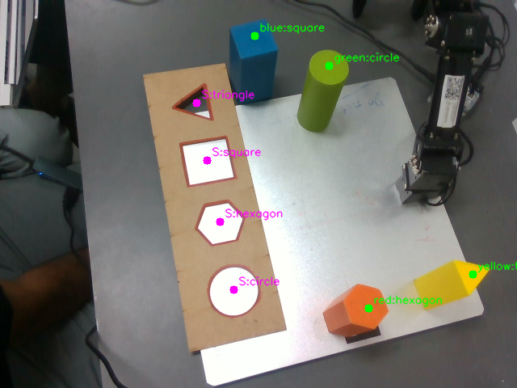
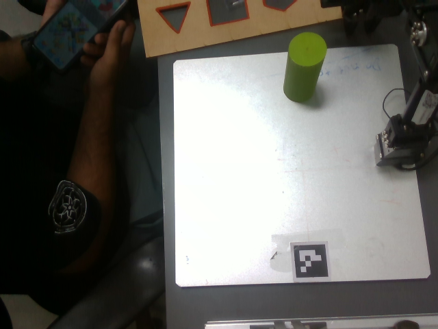

# Tri-Wizard Trial 1 — The Peg Sorting

**ME 639 Introduction to Robotics** · ROBOTIS OpenMANIPULATOR-X · Intel RealSense RGB-D · ROS 2 Humble

A person places one coloured peg anywhere in the workspace. The robot detects its colour and shape,
finds the matching socket on the board, picks the peg and inserts it — then waits for the next peg.
Pegs already in their sockets stay there and are treated as obstacles, until all four sockets are filled.
Both **keyboard teleoperation** and **full autonomy** are supported.

## 🎥 Demonstration video

**▶ [Watch the demonstration video]((https://youtu.be/XiwHk8Va8t8))**

<!-- Replace VIDEO_LINK_HERE above with the YouTube / Google Drive link (set sharing to "Anyone with the link"). -->



| Peg | Colour | Size (m) | Height |
|---|---|---|---|
| Square | blue | 0.040 × 0.040 | 98 mm |
| Triangle | yellow | 0.034 sides | 98 mm |
| Hexagon | orange | 0.020 sides | 98 mm |
| Circle | green | Ø 0.040 | 98 mm |

## Pipeline

```
RealSense RGB + aligned depth
  └─► colour segmentation (HSV thresholds + morphology)          vision/color_segmentation.py
      └─► 3-D points in the robot base frame (depth + calibration) vision/pose_estimation.py
          └─► top-face footprint → shape + yaw                      vision/shape_detection.py, scene.py
              └─► sockets = holes in the board strip                vision/socket_detection.py
                  └─► match peg ↔ socket by shape
                      └─► collision-aware pick-and-place plan       planning/pick_place_planner.py
                          (analytic IK, gripper/peg collision model, A* around obstacles)
                          └─► execute on the arm (ros2_control)     control/arm_interface.py
                              └─► verify with the camera, retry once, log result   nodes/autonomy_node.py
```

---

## 1. Setup (OS, versions, dependencies)

| Item | Version used |
|---|---|
| OS | Ubuntu 22.04 LTS (native — not WSL) |
| ROS 2 | Humble Hawksbill |
| Python | 3.10 (system) |
| Robot | ROBOTIS OpenMANIPULATOR-X, connected through a U2D2 (`/dev/ttyUSB0`) |
| Robot driver | [`ROBOTIS-GIT/open_manipulator`](https://github.com/ROBOTIS-GIT/open_manipulator) branch `humble` (ros2_control) + `dynamixel_hardware_interface` |
| Camera | 1 × Intel RealSense (serial `_332322071822`), `ros-humble-realsense2-camera` |
| OpenCV | 4.5.x from apt (`python3-opencv`, includes `cv2.aruco`) |
| Other | NumPy, PyYAML, pytest, cv_bridge, message_filters |

```bash
# ROS 2 Humble must already be installed: https://docs.ros.org/en/humble/Installation.html
sudo apt update
sudo apt install -y python3-opencv python3-numpy python3-yaml python3-pytest python3-colcon-common-extensions \
  ros-humble-cv-bridge ros-humble-message-filters ros-humble-control-msgs \
  ros-humble-ros2-control ros-humble-ros2-controllers ros-humble-realsense2-camera ros-humble-rqt-image-view \
  ros-humble-dynamixel-sdk ros-humble-dynamixel-interfaces ros-humble-dynamixel-hardware-interface

mkdir -p ~/peg_ws/src && cd ~/peg_ws/src
git clone -b humble https://github.com/ROBOTIS-GIT/open_manipulator.git
git clone https://github.com/prachiiii27/The-peg-sorting.git tri-wizard-peg-trial
cd ~/peg_ws
rosdep install --from-paths src --ignore-src -r -y
colcon build --symlink-install
source install/setup.bash          # in EVERY new terminal
```

If apt cannot find `ros-humble-dynamixel-hardware-interface`, clone `DynamixelSDK`, `dynamixel_interfaces`
and `dynamixel_hardware_interface` (branch `humble`, ROBOTIS-GIT) into `~/peg_ws/src` and rebuild.

**USB access (once):**
```bash
sudo usermod -aG dialout $USER     # then log out and back in
echo 'ACTION=="add", SUBSYSTEM=="usb-serial", DRIVER=="ftdi_sio", ATTR{latency_timer}="1"' \
  | sudo tee /etc/udev/rules.d/99-dynamixel.rules
sudo udevadm control --reload-rules && sudo udevadm trigger      # replug the U2D2
```
The 1 ms latency timer is required — with the default 16 ms the driver reports `FastSyncRead Rx Fail -3001`.

**Check without hardware:**
```bash
cd ~/peg_ws/src/tri-wizard-peg-trial
python3 -m pytest -q tests                              # 38 tests: IK, vision, planner, collision, calibration
python3 scripts/offline_vision_test.py --data data      # vision on the saved lab frame in data/
python3 scripts/workspace_check.py --board 0.008        # where the arm can reach
```

## 2. Physical layout



* Robot on the table (`table_z: 0.00`), board strip lying flat on the table.
* Socket centres must be within **20.5 cm** of the robot base (`vision.max_socket_radius_m`); sockets
  further away are rejected with a warning. Ideal: board 17–19 cm from the base.
* Pegs are placed upright, 11–18 cm from the base, not on the board.
* One RealSense above the workspace, looking down at ~30°, seeing the whole board and peg area.

## 3. Launch files / scripts (full pipeline)

| Terminal | What | Command |
|---|---|---|
| A | Robot driver | `ros2 launch open_manipulator_x_bringup hardware.launch.py` |
| B | Camera | `ros2 launch peg_trial cameras.launch.py` (serial `_332322071822` is the default) |
| C | **Full autonomy** | `./launch/run_autonomy.sh` → `autonomy.launch.py` (vision + autonomy) + evaluation at the end |
| C | Autonomy without moving the arm | `./launch/run_autonomy.sh dry_run` |
| D | **Teleop** | `./launch/run_teleop.sh` (vision in background + keyboard in this terminal) |
| — | Vision only + debug image | `ros2 launch peg_trial vision.launch.py`, then `ros2 run rqt_image_view rqt_image_view /peg_trial/debug/cam1` |
| — | Live camera viewer with reach overlay | `python3 scripts/view_camera.py` |

Helper scripts (`scripts/`):

| Script | Purpose |
|---|---|
| `calibrate_extrinsics.py` | camera → robot calibration with an ArUco marker |
| `save_frames.py` | save colour + depth + intrinsics of the camera to `data/` |
| `tune_hsv.py` | slider tool to find HSV thresholds |
| `offline_vision_test.py` | run the vision pipeline on saved frames or a synthetic scene |
| `plan_check.py` | plan a scene (order, grasp depth, route) and draw it — no robot motion |
| `orientation_check.py` | predicted peg-vs-socket rotation error for the board layout |
| `workspace_check.py` | reachable ring for pegs and sockets |
| `get_gripper_pose.py` | print the gripper x, y, z (live, or from Dynamixel Wizard angles) |
| `evaluate_timing.py` | success rate and timing from the logs (§8) |

## 4. Camera calibration

Our final setup uses **one RealSense (`cam1`)**, which sees the
whole workspace. `cameras.launch.py` starts only `cam1` (`single:=true` by default). The `cam2` entry in
`config/camera_calib.yaml` is an unused placeholder (no frames arrive, so it is ignored). A second camera can
be added by launching with `single:=false serial2:=_<SN>` and calibrating it the same way.

* **Intrinsics** (fx, fy, cx, cy) come live from the RealSense `camera_info` topic (factory calibration).
* **Extrinsics** `T_base_cam` (camera pose in the robot base frame; base = OMX `link1`, x forward, y left,
  z up) are stored in `config/camera_calib.yaml`.

```bash
python3 scripts/calibrate_extrinsics.py --make-marker      # print marker_0.png at 100 %, measure the black square
# lay the marker flat on the table, top edge pointing AWAY from the robot, centre at a measured (x, y)
python3 scripts/save_frames.py                              # -> data/cam1_color.png, cam1_depth.npy, cam1_K.npy
python3 scripts/calibrate_extrinsics.py --camera cam1 --size <side_m> --x <x_m> --y <y_m> --z 0.0
```
Reprojection error should be < 1 px. Check: a peg at a measured spot must be reported within ~5 mm
(`offline_vision_test.py --data data`). Re-calibrate whenever the camera, robot or board is moved.
Current calibration: camera ≈ 42 cm above the table, ~31° tilt.

## 5. Parameter files

| File | Contents |
|---|---|
| `config/colors.yaml` | **HSV thresholds per peg colour** (orange, yellow, green, blue), board colour, morphology kernels, colour → shape map |
| `config/camera_calib.yaml` | camera topics and `T_base_cam` |
| `config/task.yaml` | table height, peg sizes, vision limits, grasp / carry / hover / release heights, per-shape offsets, motion speeds, collision geometry, execution mode, robot topics and gripper values |

HSV thresholds used (OpenCV H 0–179, S/V 0–255):

| Peg | Lower | Upper |
|---|---|---|
| orange (hexagon) | [4, 150, 90] | [16, 255, 255] |
| yellow (triangle) | [23, 175, 150] | [32, 255, 255] |
| green (circle) | [31, 100, 40] | [85, 255, 255] |
| blue (square) | [95, 100, 50] | [130, 255, 255] |
| board (MDF) | [10, 20, 50] | [30, 180, 240] |

Re-tune under the demo lights: `python3 scripts/tune_hsv.py --image data/cam1_color.png`.

Key motion values (`task.yaml`): grip 4 mm below the peg top (never below z = 78 mm), carry at z = 113 mm,
hover at 110 mm, release at 105 mm above the socket, gripper `open +0.019` / `close −0.010`.

## 6. Usage

### Teleoperation (keyboard)
Run `./launch/run_teleop.sh` (robot driver and camera already running).

```
Cartesian:  w/s forward/back   a/d left/right   r/f up/down   [ ] step size
Joints:     q/e joint1   t/y joint2   u/i joint3   j/k joint4
Gripper:    o open   c close   g grasp (descend + clamp)   l lift 3.5 cm   p place (lower, open, retreat)
Helpers:    h home   1-4 hover over detected peg (tri, sq, hex, circ)   6-9 hover over its socket
Safety:     SPACE emergency stop   x release   ESC quit
```
Typical cycle: `1` → `g` → `l` → `6` → `p`.

### Autonomous (`execution.mode: one_by_one`)
1. Robot driver + camera running, **board empty**, nothing else on the table.
2. `./launch/run_autonomy.sh` — the arm goes home and detects the sockets
   (log: `All 4 sockets detected: [...]`), then prints `[0/4 placed] waiting for next peg`.
3. Place **one** peg upright anywhere in the workspace and take your hand away. After the peg has been still
   for ~1.5 s, the robot plans, picks, inserts, returns home and checks the insertion with the camera
   (one retry on failure).
4. When the log says `waiting for next peg` again, place the next one. Repeat until
   `RUN … finished: 4/4 pegs placed`.
5. If the log says `no safe plan — put the peg somewhere else`, move the peg (closer to the robot / away from
   placed pegs); the robot continues by itself.

Watch progress: `ros2 topic echo /peg_trial/status`. Alternative mode `all_at_once` places pegs that are all
on the table at the start.

## 7. Safety and emergency stop

* **SPACE** in the teleop terminal publishes `true` on `/peg_trial/estop` → every node commands the arm to
  hold its position and aborts the current motion. Press `x` to release.
* From any terminal: `ros2 topic pub --once /peg_trial/estop std_msgs/msg/Bool "{data: true}"`
  (release with `false`).
* `Ctrl+C` in the autonomy terminal also sends a hold command.
* **Hardware stop:** keep a hand on the 12 V power switch of the U2D2 power hub — cutting power removes
  torque (the arm sags, so keep it above the table).
* Before power-on, put the arm in the ROBOTIS start pose (folded, no joint at its limit).
* Test every new layout with `./launch/run_autonomy.sh dry_run` first.
* Only place a peg when the arm is at home and the log says `waiting for next peg`; never reach in while it moves.

## 8. Evaluation (success rate and timing)

Every autonomous run appends one row per peg to `logs/trials.csv` (success, attempts, time, predicted yaw
error, failure reason) and one row per completed run to `logs/runs.csv` (total time, e-stop).

```bash
python3 scripts/evaluate_timing.py                        # all runs
python3 scripts/evaluate_timing.py --last 1               # the last run (run_autonomy.sh does this automatically)
python3 scripts/evaluate_timing.py --last 5 --out logs/summary.md
```
It prints the success rate, first-try success (zero-failure bonus), mean time per peg, best full-run time,
a per-shape table and the failure reasons. Our development logs are included in `logs/`; their summary is in
[`docs/evaluation_summary.md`](docs/evaluation_summary.md) (it mixes dry runs and real runs from the
tuning phase).

## 9. Known limitations

* **No wrist roll on the OMX (4 joints).** The fingers always close perpendicular to the line from the base;
  closing turns a polygon peg until a face lies on a finger, so its rotation at the socket is fixed by where
  the socket is relative to the robot. The planner predicts and logs this error (`orientation_check.py`);
  per-shape place offsets in `task.yaml` were tuned on the real board.
* **Reach:** with the robot on the table and 98 mm pegs, sockets beyond ~20.5 cm cannot be served.
* Lighting changes require re-tuning `colors.yaml`.

## 10. Repository layout

```
tri-wizard-peg-trial/
├─ peg_trial/                  ROS 2 Python package
│  ├─ vision/                  color_segmentation, shape_detection, pose_estimation, socket_detection, scene
│  ├─ planning/                kinematics (OMX FK/IK), pick_place_planner, collision, path_planner, grasp_geometry
│  ├─ control/                 arm_interface (ros2_control / dry_run), teleop_keyboard
│  ├─ nodes/                   vision_node, autonomy_node
│  └─ utils/                   config, scene_buffer, calib (ArUco), synthetic (fake RGB-D for tests)
├─ launch/                     cameras / vision / autonomy launch files, run_autonomy.sh, run_teleop.sh
├─ config/                     colors.yaml, camera_calib.yaml, task.yaml
├─ scripts/                    calibration, HSV tuning, plan/orientation/workspace checks, evaluate_timing.py
├─ tests/                      pytest (no ROS or hardware needed)
├─ data/                       one saved lab frame (colour, depth, intrinsics) for offline testing
├─ logs/                       trials.csv, runs.csv
├─ docs/                       demo_guide.md, evaluation_summary.md, design notes, images
└─ README.md
```

Design notes from development (background reading): `docs/GUIDE.md`, `docs/RUN_STEPS.md`,
`docs/COLLISION_AVOIDANCE.md`. Where they differ from `config/task.yaml`, the config file is authoritative.

## License
MIT — see `LICENSE`.
